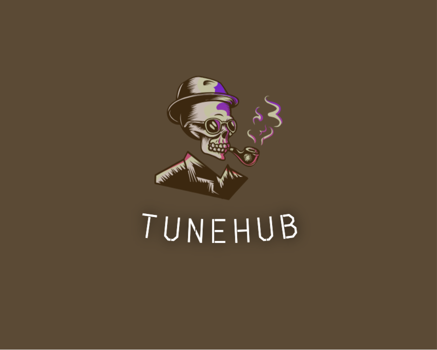
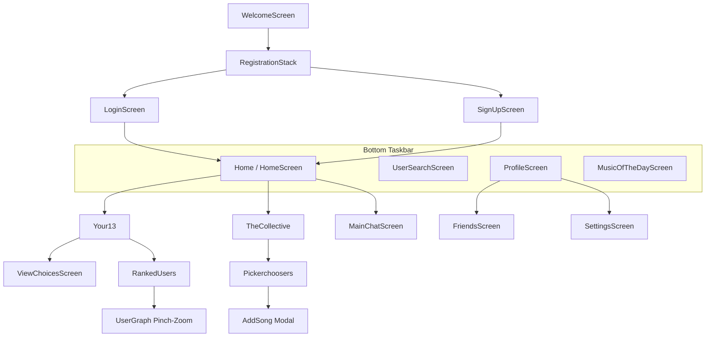

# 🎵 TuneHub (TubeApp / Chorus)

<p align="center">
  
</p>

<p align="center">
  <strong>Shape Your Very Own Community with Music — The Social Media Platform for Music Lovers & Party Regulars.</strong>
</p>

<p align="center">
  
  
  
  
  
</p>

---

## 📖 Table of Contents

- [Overview](#-overview)
- [Key Features](#-key-features)
  - [1. Your13 — Definitive Music Identity](#1-your13--definitive-music-identity)
  - [2. Sonic Compatibility Engine](#2-sonic-compatibility-engine)
  - [3. Interactive User Affinity Graph](#3-interactive-user-affinity-graph)
  - [4. The Collective Groove](#4-the-collective-groove)
  - [5. Music of the Day & Calendar](#5-music-of-the-day--calendar)
  - [6. Real-Time Chat & Friends Network](#6-real-time-chat--friends-network)
- [Tech Stack](#-tech-stack)
- [Project Structure](#-project-structure)
- [How the Compatibility Algorithm Works](#-how-the-compatibility-algorithm-works)
- [Getting Started](#-getting-started)
  - [Prerequisites](#prerequisites)
  - [Installation](#installation)
  - [Firebase Configuration](#firebase-configuration)
  - [Running the App](#running-the-app)
- [Navigation & Screen Map](#-navigation--screen-map)
- [Authors & Acknowledgments](#-authors--acknowledgments)

---

## 🌟 Overview

**TuneHub** (also developed as **TubeApp** / **Chorus**) is a full-featured music-centric social networking application built with **React Native**, **Expo**, and **Firebase**. 

Unlike conventional music platforms that focus solely on passive listening, TuneHub places **musical taste at the core of human relationships**. Users curate their ultimate 13 songs, discover like-minded listeners through multi-variable mathematical affinity algorithms, host collaborative music rooms, log their daily song selections, and interact with a live community of music lovers.

---

## ✨ Key Features

### 1. Your13 — Definitive Music Identity
- Search the entire **iTunes Search API** catalog in real-time with debounced search queries.
- Curate and save your **Top 13 Signature Tracks** that define your personality and taste.
- **Lockout Mechanism (`LockContext`)**: Prevents rapid flipping with a cooldown timer, ensuring your 13 tracks reflect genuine musical identity.

### 2. Sonic Compatibility Engine
- Custom mathematical similarity engine (`Algo.js`) that scores musical compatibility between any two users.
- Factors in **track overlap**, **artist overlap**, **genre distributions**, and **chronological release patterns**.
- Powers friend recommendations and compatibility rankings across the community.

### 3. Interactive User Affinity Graph
- **SVG Pinch-to-Zoom Visualization (`UserGraph.js`)**: Visualizes user proximity in 2D coordinate space based on mutual compatibility scores.
- The closer a user node appears to the center, the higher your musical affinity with that person.

### 4. The Collective Groove
- Community-curated playlist shelves organized around fun, expressive themes (e.g., *Child of the 80s*, *Funny Rap*, *Criminally Overlooked*, *Ex-Girlfriend's Club*, *Airplane Mode*).
- Members add songs and upvote favorites, dynamically ranking community charts.

### 5. Community Charts & Hit Lists
- Community Charts (`RankedMusicList.js`) dynamically aggregated from the 13 signature songs chosen by each listener in **Your13**.
- Real-time ranking of top tracks, top artists, and sound landscape breakdown (genres) with 30-second audio previews.

### 6. Real-Time Chat & Friends Network
- **Follow & Friend Request System (`HandlingFriends.js`)**: Send, accept, reject requests, and follow listeners.
- **1-on-1 Direct Messaging (`ChatScreen.js` / `MainChatScreen.js`)**: Instant messaging powered by Firestore real-time snapshot listeners.

---

## 🛠 Tech Stack

| Domain | Technology / Library |
|---|---|
| **Mobile Framework** | [React Native](https://reactnative.dev/) (v0.74+) with [Expo](https://expo.dev/) (SDK 51) |
| **UI Components** | [React Native Paper](https://callstack.github.io/react-native-paper/) (Material Design Dark Theme) |
| **Styling & Layout** | Vanilla React Native StyleSheet + `react-native-responsive-screen` |
| **Navigation** | [React Navigation 6](https://reactnavigation.org/) (Stack & Native Stack) |
| **Backend & Database** | [Google Firebase](https://firebase.google.com/):<br>• **Firestore** (Users, Playlists, The Collective, Daily Music, Chats)<br>• **Realtime Database** (Live Party Playlists)<br>• **Authentication** (AsyncStorage persistence)<br>• **Storage** (Profile pictures & assets) |
| **External API** | [iTunes Search API](https://developer.apple.com/library/archive/documentation/AudioVideo/Conceptual/iTuneSearchAPI/index.html) |
| **Animations & Gestures** | `react-native-reanimated`, `react-native-gesture-handler`, `lottie-react-native` |
| **Graphics & Visualization** | `react-native-svg`, `react-native-svg-pan-zoom`, `d3-force` |
| **Media & Audio** | `expo-av`, `expo-image`, `expo-image-picker`, `expo-camera` |
| **Utilities** | `axios`, `moment`, `date-fns`, `lodash.debounce`, `shortid`, `string-similarity` |

---

## 📁 Project Structure

```text
TubeApp/
├── assets/                     # Static images, icons, theme backgrounds, badge artwork
│   ├── animations/             # Lottie animations
│   ├── logo.png                # TuneHub primary logo
│   └── ...                     # Theme covers & badge images
├── AddSong.js                  # Modal to contribute songs to The Collective
├── Algo.js                     # Multi-variable musical similarity algorithm
├── App.js                      # Root application & Stack Navigator definition
├── app.json                    # Expo project configuration (permissions, plugins, icons)
├── auth-api.js                 # Firebase Authentication helper functions
├── BadgeAwarder.js             # User achievement evaluation and badge rendering
├── ChatScreen.js               # Direct messaging screen with live message stream
├── future_features/            # Staged features for future releases (Daily Tune, Coplay, The Pipeline, Party Creator)
│   ├── Coplay.js
│   ├── CreateParty.js
│   ├── CreatePipeline.js
│   ├── GuessPage.js
│   ├── JoinParty.js
│   ├── JoinPipeline.js
│   ├── MusicOfTheDayScreen.js  # Staged Daily Tune picker & calendar
│   ├── PlayShare.js
│   └── Thepipeline.js
├── CustomProgressBar.js        # Reusable custom progress indicator
├── FadingCarousel.js           # Image fade carousel for profiles
├── Feedback.js                 # Feedback forms, bug reports & rating submissions
├── firebaseConfig.js           # Firebase app, auth, db, RTDB, and storage initialization
├── FriendsScreen.js            # Follower / Following / Friend requests manager
├── GlobalStyles.js             # Common styles and theme tokens
├── GraphVisualization.js       # Force/graph visual rendering utilities
├── HandlingFriends.js          # Firestore CRUD handlers for social graph operations
├── HomeScreen.js               # Central dashboard ("Y'Wall") with main module cards
├── LockContext.js              # Global context & countdown timer for Your13 locks
├── LoginScreen.js              # User sign-in screen
├── MainChatScreen.js           # Chat threads inbox listing active conversations
├── Memoir.js                   # Song + memory post creation screen
├── MemoirHistoryScreen.js      # Chronological archive of user's past memoirs
├── NotifPage.js                # Social notifications and friend activity
├── NotificationSettings.js     # User notification preferences
├── Pickerchoosers.js           # Thematic song shelves for The Collective
├── ProfileScreen.js            # User profile (badges, history, Your13, memoirs, gallery)
├── RankedMusicList.js          # Community 13 charts (songs, artists, genres)
├── RankedUsers.js              # Users ranked by taste compatibility
├── RegistrationStack.js        # Auth stack (Login / SignUp)
├── SecuritySettings.js         # Password reset & account security settings
├── SettingsScreen.js           # Settings hub
├── SignUpScreen.js             # New user registration screen
├── SongDetailsScreen.js        # Detailed song metadata view
├── Taskbar.js                  # Bottom persistent navigation bar
├── TheCollective.js            # Themed collective music shelves
├── UpdateProfileScreen.js      # Edit bio, username, and profile details
├── UploadProfilePicture.js     # Image picker and Firebase Storage uploader
├── UserGraph.js                # SVG pinch-to-zoom user affinity radar graph
├── UserProfileScreen.js        # Public profile view for other community members
├── UserSearchScreen.js         # Community member search
├── ViewChoicesScreen.js        # Review and manage active Your13 selections
├── WelcomeScreen.js            # First launch welcome and entry point
└── Your13.js                   # Core top 13 tracks curation screen
```

---

## 🧮 How the Compatibility Algorithm Works

Musical compatibility in `Algo.js` is computed using a weighted composite similarity metric across four distinct dimensions:

$$\text{Similarity}(A, B) = w_1 \cdot J_{\text{track}} + w_2 \cdot J_{\text{artist}} + w_3 \cdot \cos(\vec{G}_A, \vec{G}_B) + w_4 \cdot L_{\text{release}}$$

| Metric | Formulation | Weight | Description |
|---|---|---|---|
| **Track Overlap ($J_{\text{track}}$)** | **Jaccard Similarity** | **50%** ($w_1 = 0.50$) | Evaluates exact matches between user song libraries ($A \cap B / A \cup B$). |
| **Artist Overlap ($J_{\text{artist}}$)** | **Jaccard Similarity** | **35%** ($w_2 = 0.35$) | Measures common affinity for artists even when song choices differ. |
| **Genre Distribution ($\cos(\vec{G}_A, \vec{G}_B)$)** | **Cosine Similarity** | **7.5%** ($w_3 = 0.075$) | Compares frequency vectors of music genres to identify taste alignment. |
| **Era / Release Dates ($L_{\text{release}}$)** | **Levenshtein Distance** | **7.5%** ($w_4 = 0.075$) | Analyzes normalized chronological string similarity of album release eras. |

The resulting similarity score ranges from **0.0 (no overlap)** to **1.0 (identical musical soulmates)** and is represented visually in the **User Affinity Graph**.

---

## 🚀 Getting Started

### Prerequisites

Ensure you have the following installed on your machine:
- [Node.js](https://nodejs.org/) (v18.x or v20.x recommended)
- [npm](https://www.npmjs.com/) or [yarn](https://yarnpkg.com/)
- [Expo CLI](https://docs.expo.dev/get-started/installation/) (`npm install -g expo-cli` or via `npx expo`)
- [Expo Go](https://expo.dev/go) app on your iOS / Android device, or a configured iOS Simulator / Android Emulator.

### Installation

1. **Clone the repository:**
   ```bash
   git clone https://github.com/your-username/TubeApp.git
   cd TubeApp
   ```

2. **Install project dependencies:**
   ```bash
   npm install
   ```

### Firebase Configuration

The application requires Firebase services. The project is pre-configured with Firebase in `firebaseConfig.js`. 

To connect to your own Firebase instance:
1. Create a project in the [Firebase Console](https://console.firebase.google.com/).
2. Enable the following services:
   - **Authentication** (Email/Password provider enabled)
   - **Cloud Firestore Database**
   - **Realtime Database**
   - **Firebase Storage**
3. Update `firebaseConfig.js` with your project's credentials:

```javascript
const firebaseConfig = {
  apiKey: "YOUR_API_KEY",
  authDomain: "your-project.firebaseapp.com",
  databaseURL: "https://your-project-default-rtdb.firebaseio.com",
  projectId: "your-project-id",
  storageBucket: "your-project.appspot.com",
  messagingSenderId: "YOUR_MESSAGING_SENDER_ID",
  appId: "YOUR_APP_ID"
};
```

### Running the App

Start the Expo development server:

```bash
npm start
```
*or*
```bash
npx expo start
```

From the terminal interface:
- Press `i` to open the **iOS Simulator**.
- Press `a` to open the **Android Emulator**.
- Press `w` to run in the **Web browser**.
- Scan the QR code with your mobile camera (iOS) or the **Expo Go** app (Android) to test on a physical device.

---

## 🗺 Navigation & Screen Map



---

## 👥 Authors & Acknowledgments

- **Lead Developers**: Samy & Marly ([@Samy/Marly](https://github.com/))
- **Design & Concept**: TuneHub / Chorus Team
- **Third-Party APIs**: [iTunes Search API by Apple](https://developer.apple.com/library/archive/documentation/AudioVideo/Conceptual/iTuneSearchAPI/index.html)
- **Photography & Assets**: Royalty-free imagery courtesy of [Unsplash](https://unsplash.com/)

---

<p align="center">
  Made with ❤️ for music enthusiasts worldwide.
</p>
